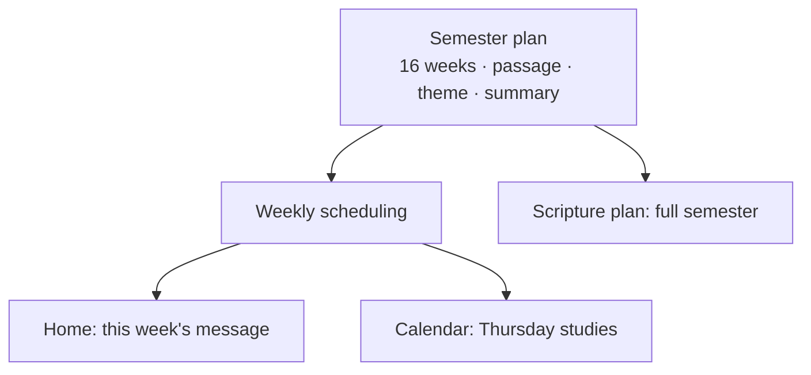

  

<h1 align="center">Chaplain Platform</h1>

<strong>A chapter website that gives Phi Delta Theta's NC Epsilon chapter one place for weekly Bible study, the semester scripture plan, and chaplain resources.</strong>

  &nbsp;
  &nbsp;
  

Live and in use · Built by Davis Higgins, Chaplain of NC Epsilon at UNC Charlotte

---

## See it in motion

  

Real capture of chaplain.davishiggins.com: home, calendar, and scripture plan. <a href="assets/demo.png">Static frame</a>

## What it does

- **This week, first.** The home page leads with this week's message and passage, and it moves to the next study automatically each week. Nobody has to remember to update it.
- **A calendar members can trust.** A month view marks every Thursday Bible study with its passage, so the whole semester is visible at a glance.
- **A semester with a shape.** A 16-week scripture plan moves through John, Philippians, and Colossians, with a title, a theme, and a short summary for discussion each week.

## Why I built it

As chaplain, I found that everything the chapter needed for its spiritual life was scattered across group chats and documents. Devotionals and weekly direction lived wherever they were last posted, and the same information got re-sent every week.

So I built the chapter one home organized around how it actually works: the current week leads, and the full semester sits underneath it.

## What I built

I designed and built the site end to end, and I wrote and maintain the semester plan it presents:

- Home, calendar, scripture plan, about, and contact views
- Scheduling that always shows the right study for the current week
- One place that holds the whole semester plan, so updating the site is quick
- Chapter-branded visuals, motion, and a phone-first layout

<strong>How it's put together</strong>

 

| Decision | Why |
|---|---|
| **The calendar drives the content** | The current study updates itself on schedule, so the site stays accurate all semester without anyone touching it. |
| **One plan for the whole semester** | Every passage, title, and summary lives in one place, so planning next semester means replacing the plan, not editing pages. |
| **Dates that mean the chapter's dates** | A Thursday study always shows on Thursday, wherever a member's phone thinks it is. |

## Screens

<table>
  <tr>
    <td width="62%"></td>
    <td rowspan="2" width="38%" align="center"></td>
  </tr>
  <tr>
    <td></td>
  </tr>
</table>

Home with this week's message · Bible study calendar · Home on mobile

## Technology

| Layer | Technology |
|---|---|
| App | React, Vite, JavaScript |
| Styling | Tailwind CSS |
| Motion | Framer Motion, GSAP |
| Hosting | Vercel |

---

  &nbsp;
  

© 2026 Davis Higgins. The Phi Delta Theta name, letters, and shield are marks of Phi Delta Theta Fraternity and appear here as used on the chapter's own site.

