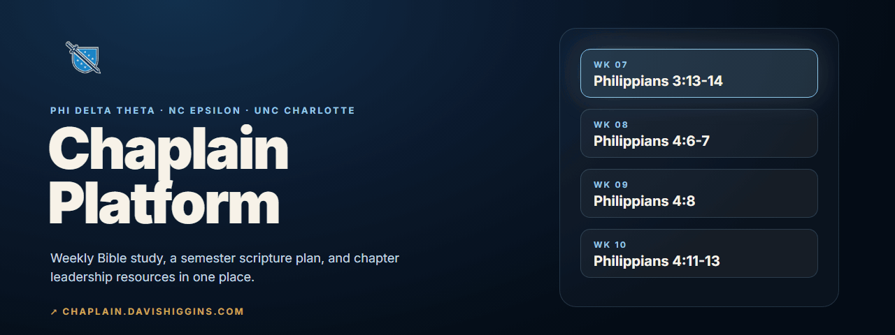
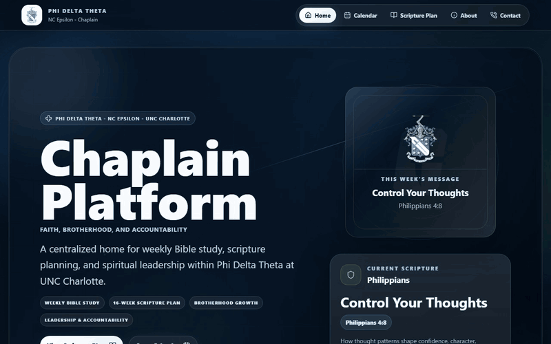
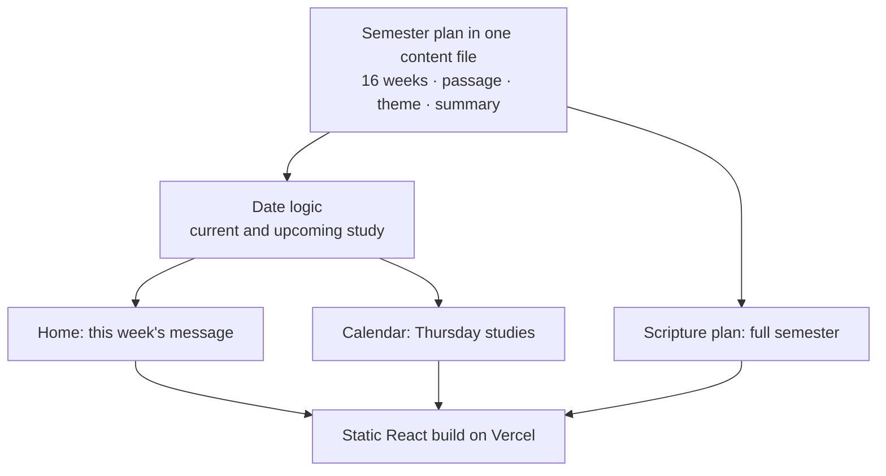
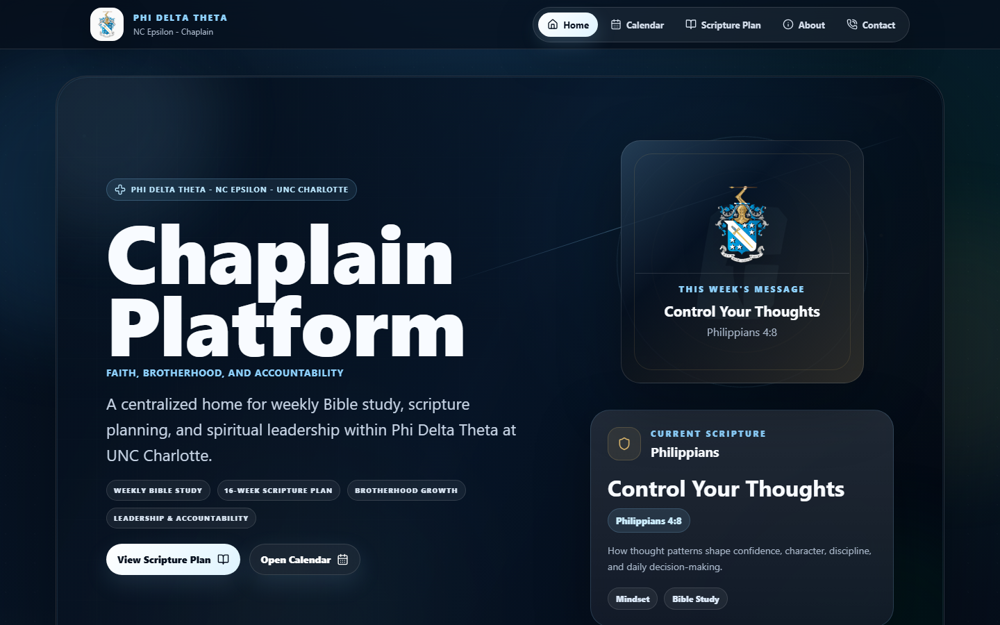
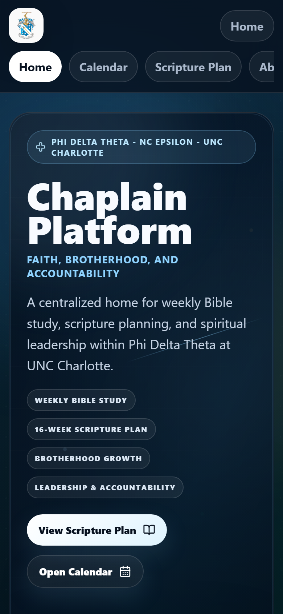
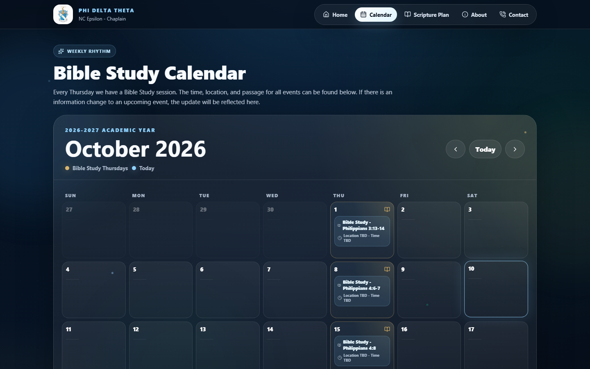

  

<h1 align="center">Chaplain Platform</h1>

  <strong>A chapter website that gives Phi Delta Theta's NC Epsilon chapter one place for weekly Bible study, the semester scripture plan, and chaplain resources.</strong> 
  <a href="https://chaplain.davishiggins.com"><strong>Visit the platform ↗</strong></a> · <a href="https://www.higginsd.com/work/phi-delta-theta">Case study</a> · <a href="https://davishiggins.com">Davis Higgins</a>

Live · Built by Davis Higgins, Chaplain of NC Epsilon at UNC Charlotte · Fall 2026 semester plan

---

## See it in motion

  

Real capture of chaplain.davishiggins.com: home, calendar, and scripture plan. <a href="assets/demo.png">Static frame</a>

## What it does

- **This week, first.** The home page leads with this week's message and passage, and it switches to the next scheduled study automatically each week. Nobody has to remember to update it.
- **A calendar members can trust.** A month view marks every Thursday Bible study with its passage, so the semester is visible at a glance.
- **A semester with a shape.** A 16-week scripture plan moves through John, Philippians, and Colossians. Each week has a title, a theme, and a short summary for discussion.

## Why I built it

As chaplain, I found that everything the chapter needed for its spiritual life was scattered across group chats and documents. Devotionals and weekly direction lived wherever they were last posted. Members had no reliable place to look, and the same information got re-sent every week.

So I built the chapter one home organized around how it actually works: the current week leads, and the full semester sits underneath it.

## What I built

I designed and built the site end to end, and I wrote and maintain the semester plan it presents:

- Home, calendar, scripture plan, about, and contact views
- Date logic that picks the current or upcoming study and labels each Thursday on the calendar
- A single content file that holds the whole semester plan, so updating the site means editing one file
- Chapter-branded visuals, motion, and a phone-first layout

## How it's put together

### Engineering decisions

| Decision | Why |
|---|---|
| **The calendar drives the content** | The current study is computed from today's date against the plan, and it rolls over at the start of each Friday. The site stays current through the semester without anyone touching it. |
| **One file is the whole semester** | Every passage, title, theme, and summary lives in one data file read by all views. Planning next semester means replacing that file, not editing pages. |
| **Local dates, not UTC** | Plan dates are parsed as local calendar dates, so a Thursday study never shows up on Wednesday evening for members whose time zone shifts the UTC date. |

## Screens

<table>
  <tr>
    <td width="62%"></td>
    <td rowspan="2" width="38%" align="center"></td>
  </tr>
  <tr>
    <td></td>
  </tr>
</table>

Home with this week's message · Bible study calendar · Home on mobile

## Technology

| Layer | Technology | Responsibility |
|---|---|---|
| App | React, Vite, JavaScript | Views, date logic, content rendering |
| Styling | Tailwind CSS | Chapter palette and responsive layout |
| Motion | Framer Motion, GSAP | Page transitions and reveals |
| Hosting | Vercel | Static deployment |

## Status and scope

- **Live and in use** for the Fall 2026 semester at NC Epsilon.
- **Content is edited in code.** There's no sign-in or publishing dashboard. Weekly content comes from the semester plan file, which I maintain as chaplain.
- **Nothing private.** The site holds the public study plan only: no member lists, prayer requests, or internal chapter documents.

## About this repository

This is a documentation-only showcase. The site's source isn't included here.

**[Visit the platform ↗](https://chaplain.davishiggins.com)** · Built by [Davis Higgins](https://davishiggins.com) · [More of my work](https://github.com/DavisHiggins)

© 2026 Davis Higgins. Text and images in this repository are shared for portfolio viewing. The Phi Delta Theta name, letters, and shield are marks of Phi Delta Theta Fraternity and appear here as used on the chapter's own site. This is a chapter project, not an official site of the General Fraternity.
